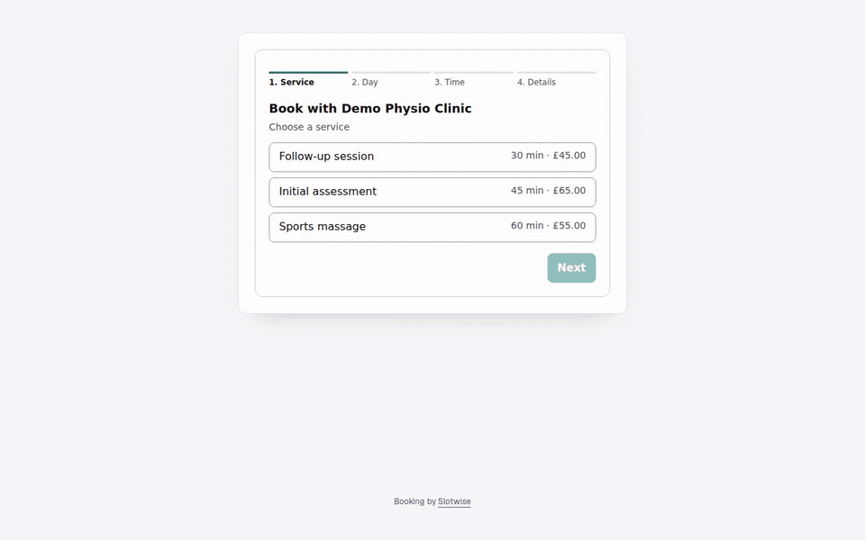
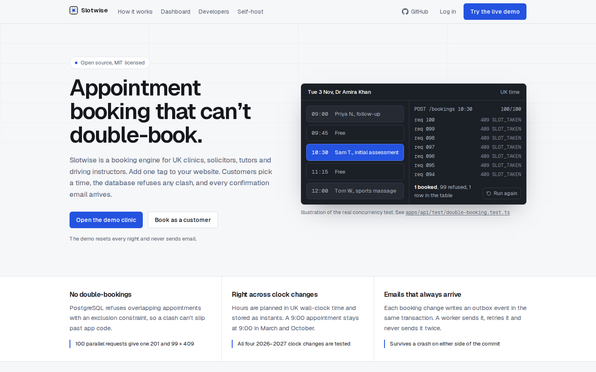
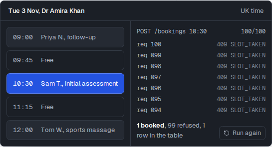
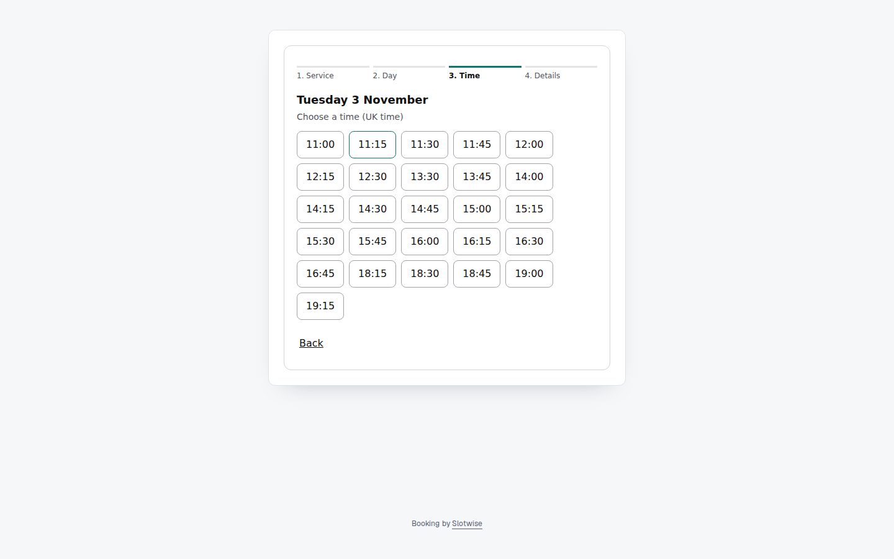
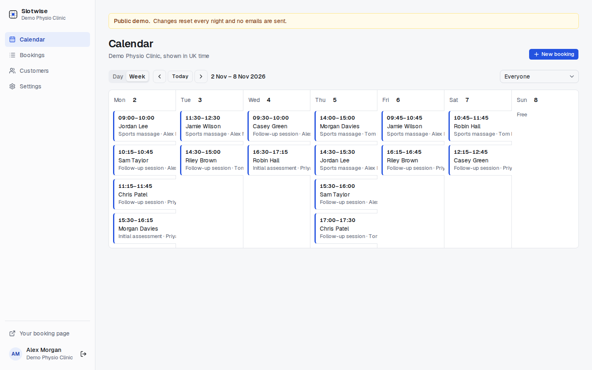
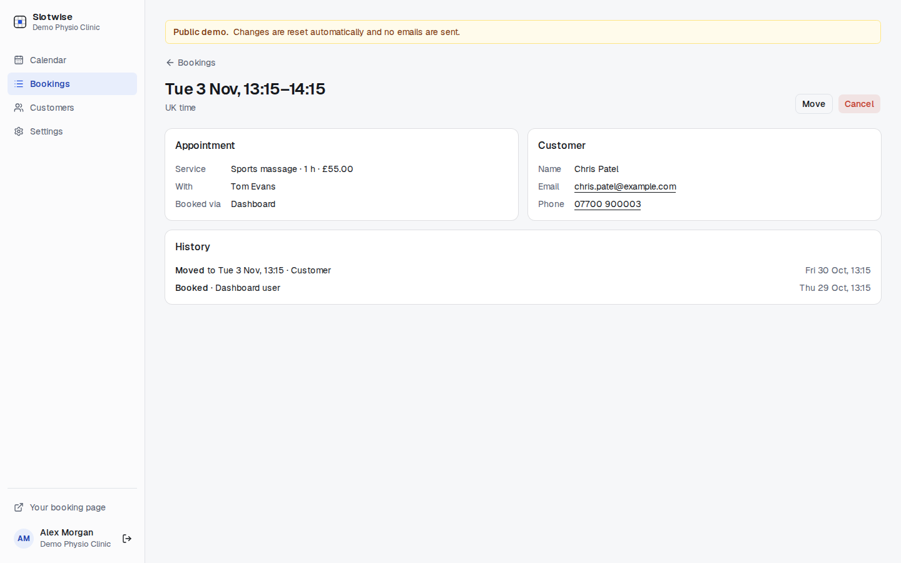
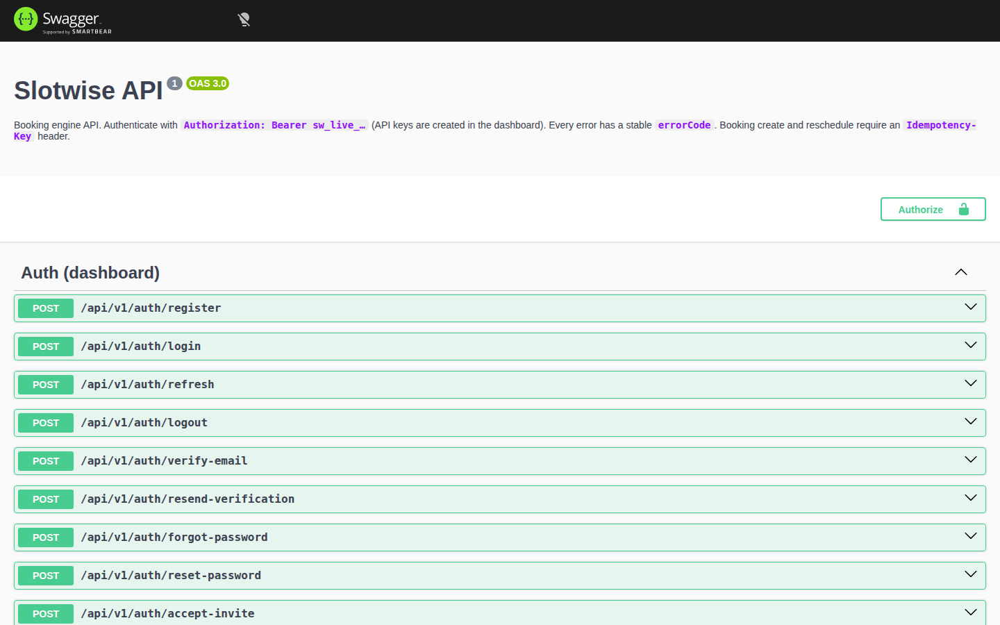
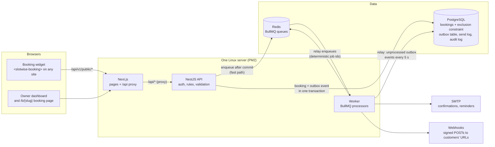

# Slotwise

**Appointment booking for UK businesses that can't double-book: a REST API, an embeddable widget, an owner dashboard and a background worker.**

[](https://github.com/ToukirOfficial/slotwise/actions/workflows/ci.yml)
[](https://slotwise.toukirahmedrony.com)




> **Try it in 30 seconds**
>
> - **[Open the live demo](https://slotwise.toukirahmedrony.com/login?demo=1)**: the demo login is pre-filled, just click **Log in**
>   (`demo@slotwise.example` / `demo-physio-2026`).
> - **[Book as a customer](https://slotwise.toukirahmedrony.com/b/demo-physio)** on the clinic's public booking page.
> - **[Read the API docs](https://slotwise.toukirahmedrony.com/api/docs)** (OpenAPI, every error has a stable `errorCode`).
>
> The demo clinic resets every hour and never sends email.

### Proof

| What | Result | Where it comes from |
|---|---|---|
| Tests | **183 passing** (49 engine, 7 web, 127 API) on **PostgreSQL 16 and 18** | [CI](https://github.com/ToukirOfficial/slotwise/actions/workflows/ci.yml), on every push |
| Double-booking | **100 parallel requests** for one slot → **1 booking, 99 rejected** (409 `SLOT_TAKEN`) | [`double-booking.test.ts`](apps/api/test/double-booking.test.ts), real PostgreSQL |
| Slot engine | **~10 ms** for one staff member over 30 days | `pnpm --filter @slotwise/engine bench` |
| Availability endpoint | **~16 ms** median locally, **~37 ms** on the live server (HTTP + database) | Same query on the demo data |
| Widget | **~5 KB** gzipped (4.9 KB), one file, no dependencies | `packages/widget` build output |

---

An open-source booking engine for UK businesses that sell 1-to-1 appointments (clinics, solicitors, tutors,
driving instructors). It comes with a REST API, an embeddable booking widget, an owner dashboard and a
background worker.

A business adds one script tag and one HTML tag to its website. Its customers can then book appointments that:

- **can never double-book**, even when 100 requests arrive for the same slot at once;
- **stay correct across UK clock changes**;
- trigger **reliable emails** (confirmation, reminder, cancellation) that are never lost and practically never duplicated.

```html
<script src="https://<your-slotwise-domain>/widget/v1.js" defer></script>
<slotwise-booking business="demo-physio"></slotwise-booking>
```

**Running your own public demo:** set `PUBLIC_DEMO=true`. Sign-up, invites and password reset are switched off
(403 `DEMO_MODE`, hidden in the UI) and mail only goes to the log.

---

## Screenshots

| | |
|---|---|
|  |  |
| **Landing page.** The hero states the guarantee and shows it. | **100 requests, one slot.** An illustration of what the [double-booking test](apps/api/test/double-booking.test.ts) proves. |
|  |  |
| **Booking page** (`/b/demo-physio`), choosing a time. | **Dashboard calendar**, opened on the week with upcoming bookings. |
|  |  |
| **Booking detail** with its audit trail. | **API docs** at `/api/docs`. |

---

## Contents

- [Screenshots](#screenshots)
- [Run it locally](#run-it-locally)
- [Hard problems and how I solved them](#hard-problems-and-how-i-solved-them)
- [Your first API booking](#your-first-api-booking-under-15-minutes)
- [Webhooks](#webhooks)
- [Architecture](#architecture)
- [Security](#security)
- [Tests](#tests)
- [Decisions](#decisions)
- [Contributing](#contributing)

## Run it locally

You need **Node.js 24**, **pnpm**, **PostgreSQL 16 or newer** and **Redis** running locally. No Docker.

```bash
git clone https://github.com/ToukirOfficial/slotwise.git && cd slotwise
pnpm run setup   # writes .env with fresh secrets, installs, creates slotwise_dev + slotwise_test, migrates, seeds the demo
pnpm dev         # web http://localhost:8015 · API http://localhost:8115 · worker
```

(It's `pnpm run setup`, not `pnpm setup`, because `pnpm setup` is a built-in pnpm command.)

- Dashboard: <http://localhost:8015> · API docs (Swagger): <http://localhost:8015/api/docs> · OpenAPI JSON: `/api/openapi.json`
- No email is ever sent locally. Every message is written to `tmp/mail/*.eml`, so you can open the `.ics` invites.
- `pnpm typecheck && pnpm lint && pnpm test && pnpm build` is exactly what CI runs.

## Hard problems and how I solved them

### 1. Double-booking under concurrency

Check-then-insert in application code isn't safe: two requests can both see 10:00 as free. So PostgreSQL
refuses the overlap itself, with an exclusion constraint on each staff member's blocked time (the appointment
plus the service's buffers):

```sql
ALTER TABLE bookings ADD CONSTRAINT bookings_no_overlap
  EXCLUDE USING gist (staff_id WITH =, tstzrange(blocked_start, blocked_end, '[)') WITH &&)
  WHERE (status = 'confirmed');
```

- `[)` lets one booking start exactly when the previous one ends. Cancelled bookings don't block the diary.
  That `WHERE` clause is why this isn't PostgreSQL 18's `UNIQUE … WITHOUT OVERLAPS` (unique constraints
  can't have one).
- Prisma can't express the constraint, so it lives in a hand-edited migration. `prisma migrate diff` shows no
  drift, so later migrations never drop it.
- With Prisma 7 + `@prisma/adapter-pg`, SQLSTATE `23P01` arrives in `meta.driverAdapterError.cause`. One helper,
  `isSlotConflict`, checks that code and the constraint name, and maps it to **409 `SLOT_TAKEN`**. A test triggers
  the real error against real PostgreSQL. It never uses a mocked error.
- "Any staff" tries eligible people in a fixed order (fewest bookings that day, then id), each inside a
  `SAVEPOINT`, so one conflict doesn't abort the transaction.
- **Proof:** 100 parallel `POST /bookings` for one slot give exactly **1 × 201 and 99 × 409**, and one row in the table.

### 2. UK clock changes

**Bookings are instants** (`timestamptz`, UTC). **Working hours are wall-clock minutes** in `Europe/London`
(540 = 09:00, never UTC). All conversion goes through the Temporal API, with the DST rules written out
explicitly:

| Date | What happens | What the engine does |
|---|---|---|
| Sun 29 Mar 2026 | 01:00 GMT → 02:00 BST; 01:00–01:59 local doesn't exist | No slot from 01:00 to 01:59. A 09:00 window still gives 09:00 local (08:00 UTC) |
| Sun 25 Oct 2026 | 02:00 BST → 01:00 GMT; 01:00–01:59 happens twice | Each local time is offered once, at its first (BST) occurrence. 09:00 local = 09:00 UTC |
| 28 Mar / 31 Oct 2027 | Same again | Same tests pass, so nothing is hard-coded to 2026 |

Durations and buffers are real elapsed minutes. The UI always shows business time, labelled "UK time".

### 3. Never lose an email, never send one twice

Exactly-once delivery to SMTP is impossible, so the design is **at-least-once with deduplication**:

- **Outbox:** the booking change and an `outbox_events` row commit together. Right after commit, the API turns
  the event into jobs. A relay in the worker sweeps unprocessed events every 5 s with `FOR UPDATE SKIP LOCKED`.
  A crash between commit and enqueue loses nothing.
- **Deterministic job ids:** `email-confirm-<booking>-v<version>`, `reminder-<booking>`,
  `webhook-<event>-<endpoint>`. BullMQ rejects `:` in custom ids, so it's hyphens only, built by one helper
  that a test runs through real BullMQ.
- **Send log:** `email_log` has a unique key on (booking, kind, version). The worker checks it before sending
  and writes it after SMTP accepts.
- **Stale jobs:** a reminder carries the booking version. If the booking was moved or cancelled since, it sends nothing.
- **Redis loss:** an hourly reconcile re-creates any missing reminder. PostgreSQL is the source of truth.
- **The honest trade-off:** a crash *after* SMTP accepts but *before* the `email_log` row is written can send
  one duplicate. Every other failure is either retried or deduplicated.

### 4. Fast, correct slot finding

`packages/engine` is a **pure function** (no database, no clock, no I/O):
`findSlots({ zone, fromDate, toDate, now, weeklyHours, overrides, busy, service, rules })`. The API loads hours,
overrides and existing bookings in one query per table and passes them in. Busy intervals are merged and
scanned with a single moving pointer, so the cost is linear.

- **49 unit tests** run in milliseconds: split shifts, buffers, notice, horizon, overrides, and all four
  2026–2027 clock changes.
- **Speed:** the engine alone takes about **10 ms** for one staff member over 30 days (Vitest bench,
  `pnpm --filter @slotwise/engine bench`). The full public endpoint, including HTTP and database, takes about
  **16 ms (median)** for the same query on the demo data. The target was under 200 ms.

### 5. Keeping businesses apart

- A global guard puts `{ userId, businessId, role, staffId }` (or the API key's business) on each request.
  `businessId` **only** comes from there, never from the URL or the body.
- Every tenant query filters by `business_id`. Reads by id use `findFirst({ where: { id, businessId } })`, so
  another business's id is **404, not 403**. Staff logins are further limited to their own `staff_id`.
- Routes are **deny-by-default**. Each one must say `@Public()` or `@Allow('owner' | 'staff' | 'apiKey')`, or the
  guard refuses it.
- Tests: logged in as business A, every read, update and delete of business B's bookings, services, staff,
  hours, overrides, customers, API keys and webhooks returns 404. Staff can't see a colleague's diary.

## Your first API booking (under 15 minutes)

1. In the dashboard, open **Settings → API keys** and create a key. It's shown once: `sw_live_<prefix>_<secret>`.
2. Find a service and a free time:

```bash
KEY=sw_live_…; API=http://localhost:8015/api/v1
curl -s -H "Authorization: Bearer $KEY" "$API/services"
curl -s -H "Authorization: Bearer $KEY" "$API/availability?serviceId=<id>&from=2026-11-02&to=2026-11-08"
```

3. Book it. The `Idempotency-Key` makes retries safe:

```bash
curl -s -X POST "$API/bookings" \
  -H "Authorization: Bearer $KEY" -H "Content-Type: application/json" \
  -H "Idempotency-Key: $(uuidgen)" \
  -d '{"serviceId":"<id>","staffId":"any","startsAt":"2026-11-03T10:00:00Z",
       "customer":{"name":"Sam Taylor","email":"sam@example.com","phone":"07700 900123"}}'
```

Keys can list services and staff, read availability, and list, read, create, cancel and reschedule bookings.
They can't touch settings, keys, webhooks or staff accounts. The limit is 60 requests a minute per key (429
with `Retry-After`). Every error has a stable `errorCode` (`SLOT_TAKEN`, `IDEMPOTENCY_KEY_REUSED`, …). Full
reference: `/api/docs`, generated from the same Zod schemas that validate requests, so the docs can't drift
from the behaviour.

## Webhooks

Events: `booking.created`, `booking.cancelled`, `booking.rescheduled`. Each POST is signed:

```
Slotwise-Signature: t=<unix seconds>,v1=<hex HMAC-SHA256(secret, "<t>.<raw body>")>
```

Verify it with the **raw** body, and reject timestamps older than 5 minutes:

```ts
import { createHmac, timingSafeEqual } from 'node:crypto';

export function verifySlotwise(secret: string, rawBody: string, header: string): boolean {
  const { t, v1 } = Object.fromEntries(header.split(',').map((p) => p.split('=')));
  if (!t || !v1 || Math.abs(Date.now() / 1000 - Number(t)) > 300) return false;
  const expected = createHmac('sha256', secret).update(`${t}.${rawBody}`).digest();
  const given = Buffer.from(v1, 'hex');
  return given.length === expected.length && timingSafeEqual(given, expected);
}
```

Payloads carry ids and times only. Fetch customer details with your API key. Failed deliveries retry 8
times over about a day, every attempt appears in the delivery log, and you can resend or send a test
event from the dashboard.

## Architecture



More detail, including how the outbox keeps emails and webhooks from being lost: [`docs/architecture.md`](docs/architecture.md).

```
slotwise/                     pnpm workspaces + Turborepo
├── apps/api/                 NestJS 12 — REST API + Swagger (src/main.ts) and the BullMQ worker (src/worker.ts)
├── apps/web/                 Next.js 16 — dashboard, /b/{slug}, /manage/{token}; serves /widget/v1.js
├── packages/shared/          Zod 4 schemas + types (validation, serialization, OpenAPI, frontend types)
├── packages/engine/          Pure slot engine (Temporal) — most of the unit tests
└── packages/widget/          <slotwise-booking> Web Component, Shadow DOM, esbuild → one file (~5 KB gzipped)
```

Request flow: widget → `/api/v1/public/*` → NestJS → PostgreSQL (+ outbox) → worker → SMTP and webhooks.
Next.js only displays. Every auth, permission and business rule lives in NestJS.

| Choice | Why |
|---|---|
| PostgreSQL exclusion constraint | The database, not app code, guarantees no overlap. It's the only safe place |
| Outbox + deterministic job ids + send log | Survives crashes on either side of the commit, and dedupes retries |
| Separate worker process | Email and webhook latency or retries never block API requests |
| Pure engine package | The trickiest logic is fast to test exhaustively, without a database |
| Temporal API | Explicit wall-clock vs instant, explicit DST handling. Native in Node 26 |
| Web Component + Shadow DOM | Works on any site (WordPress, Laravel, plain HTML) with no CSS clashes |
| Zod as Standard Schema | NestJS 12 validates and serializes with the same schemas that generate the docs |

Stack: TypeScript 6 (strict), NestJS 12, Next.js 16.3, Prisma 7 + PostgreSQL 16 or newer, Redis + BullMQ, Zod 4,
Temporal, Tailwind + shadcn/ui, Vitest + Supertest. Runs on any Linux server with PM2. No Docker, no cloud services.

## Security

- Passwords are hashed with **argon2id**. The session is a 15-minute access token plus a **rotating refresh
  token** in `httpOnly`, `Secure`, `SameSite=Lax` cookies. Reusing an old refresh token revokes the whole family.
  Writes that rely on cookies must come from the dashboard's own `Origin`.
- API keys, refresh tokens, email tokens and manage links are stored as **SHA-256 hashes** only. Webhook
  secrets are **AES-256-GCM** encrypted.
- Login, registration, password reset, public availability, public booking and API keys are all rate-limited.
- **Webhook SSRF protection:** HTTPS only in production. The host is resolved and every address checked
  (loopback, private, link-local and metadata ranges are blocked). The connection goes to the vetted IP,
  redirects aren't followed, and there's a 10 s timeout.
- Customer personal data lives in one table. The audit log stores ids, status and times only. Owners can erase
  a customer, and a daily job erases anyone whose last booking ended more than the retention period ago (24
  months by default).
- Nothing personal or secret is ever logged. Every log line is JSON with a request id.

## Tests

`pnpm test` runs **183 tests**, all passing: 49 engine unit tests, 7 web tests and 127 API integration tests against real
PostgreSQL and Redis (no database mocks). They cover only what matters:

| Area | Covers |
|---|---|
| Engine | Split shifts, buffers, notice, horizon, step, overrides, all four 2026–2027 clock changes, working-hours check |
| Double-booking | 100 concurrent bookings → 1 success; "any staff" savepoints; reschedule into a taken slot leaves the old slot intact; the real `23P01` error shape |
| Idempotency | Same key twice, 10 concurrent with one key, a different body → 422, a failed attempt leaves no key |
| Emails and reminders | Relay after a lost fast path, double processing enqueues once, stale reminder sends nothing, reconcile restores a lost reminder, send-log dedupe, BullMQ accepts the job ids (and rejects `:`) |
| Auth | Login, refresh rotation, reuse revokes the family, rate limit, single-use email tokens |
| Tenancy and permissions | The matrix in hard problem 5, staff limits, API key scope, demo restrictions, erasure permissions |
| Webhooks | Signature verification, private-IP rejection after DNS resolution, redirects not followed, retries logged |
| Public demo | With `PUBLIC_DEMO=true`, sign-up, invite acceptance and password reset return 403 `DEMO_MODE`; SMTP is never used; the seed covers the past 7 days and next 14; demo businesses are capped (403 `DEMO_LIMIT`) and re-seeding clears the public cache |
| Forms | Every form posts with `method="post"` and stays disabled until hydrated, so form data can never end up in a URL |

## Decisions

Short notes on the non-obvious choices, in [`docs/decisions/`](docs/decisions):
[exclusion constraint](docs/decisions/0001-exclusion-constraint.md) ·
[time and the pure engine](docs/decisions/0002-time-and-pure-engine.md) ·
[idempotency](docs/decisions/0003-idempotency.md) ·
[manage links](docs/decisions/0004-manage-links.md) ·
[outbox and worker](docs/decisions/0005-outbox-and-worker.md) ·
[Web Component widget](docs/decisions/0006-web-component-widget.md) ·
[webhook security](docs/decisions/0007-webhook-security.md)

## Contributing

Issues and pull requests are welcome: see [CONTRIBUTING.md](CONTRIBUTING.md). Please report security issues
privately as described in [SECURITY.md](SECURITY.md). Release notes are in [CHANGELOG.md](CHANGELOG.md).

## License

MIT, © 2026 Toukir Ahmed Rony.
