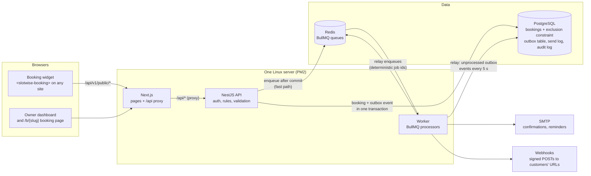

# Architecture

- **Next.js only displays.** Every auth check, permission and business rule lives in the NestJS API. Next.js serves
  the pages and the widget script, and proxies `/api/*` to the API on the same origin.
- **The database prevents double-booking.** An exclusion constraint on confirmed bookings means two overlapping
  bookings can't both commit, however many requests arrive at once.
- **Emails and webhooks are never lost.** A booking change and its outbox event are written in the same
  transaction. After the commit the API enqueues the job straight away (fast path). The worker also relays any
  outbox event that wasn't processed (a crash between commit and enqueue). Deterministic job ids and the send log
  stop duplicates.
- **The worker is a separate process**, so slow SMTP servers or failing webhook endpoints never hold up an API
  request.

See [`docs/decisions/`](decisions) for why each of these was chosen.
